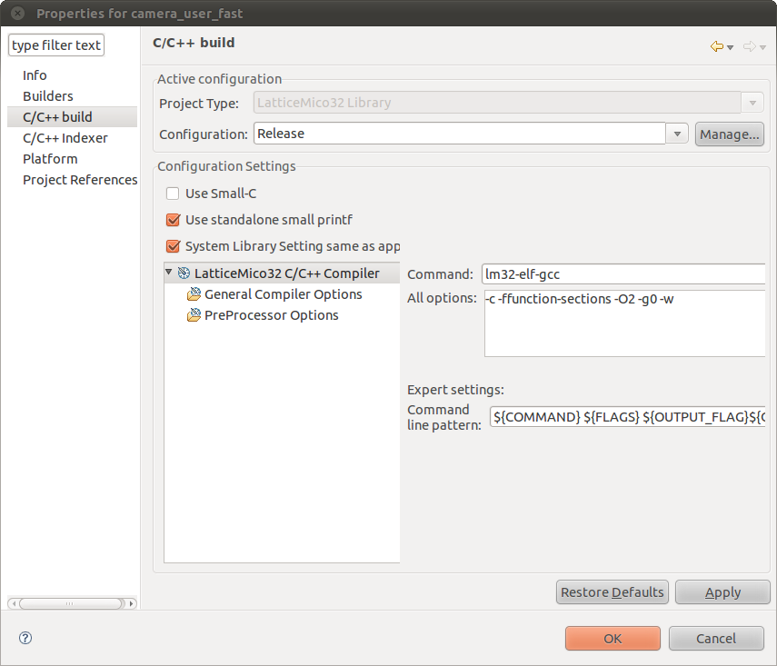

# File:Mico32 library project configuration.png

[Download original file](../assets/uploads/Mico32_library_project_configuration--3791c44bbc.png)

Original upload: **Ryosab81**, 2011-02-15T17:00:01Z; 82,234 bytes; `image/png`.

Upload comment: This screenshot shows the mico32 library project configuration panel

This screenshot shows the mico32 library project configuration panel

---

## Archive provenance

- [Original page](http://erika.tuxfamily.org/wiki/index.php?title=File%3AMico32_library_project_configuration.png) · [Archived source revision 2637](http://erika.tuxfamily.org/wiki/index.php?oldid=2637)
- Last source edit: 2011-02-15T17:00:01Z. Source retrieved on 2026-11-06; Markdown conversion completed on 2026-11-07.
- Original contributors recorded in exported history: Ryosab81.
- [Original MediaWiki source](../source/wikitext/1791.mediawiki) · [Original editing history](../source/history/batch-041.xml)
- [Attribution and licensing notice](../NOTICE.md). Original file-specific notices, where present, remain applicable.
