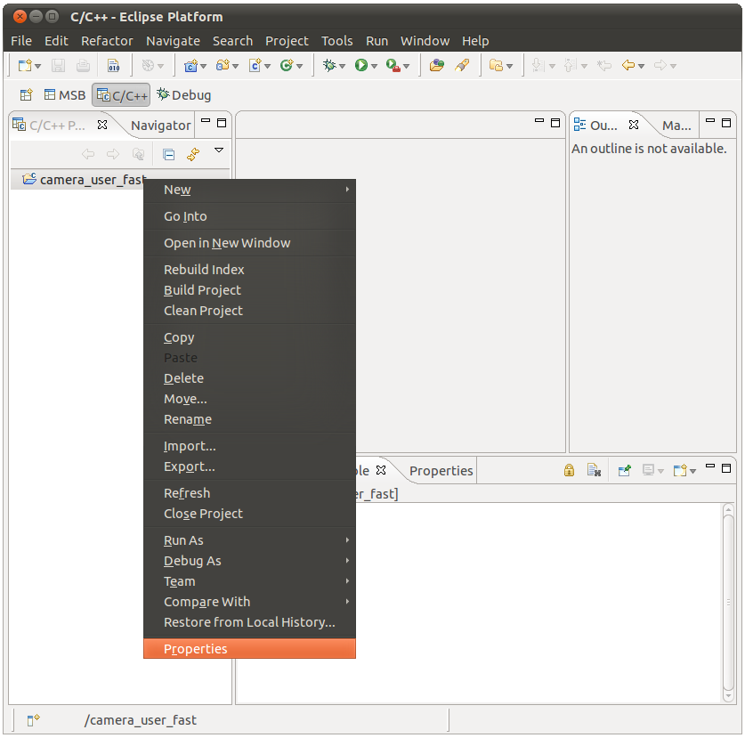

# File:Mico32 library project properties.png

[Download original file](../assets/uploads/Mico32_library_project_properties--81c2c4c80b.png)

Original upload: **Ryosab81**, 2011-02-15T16:59:11Z; 101,469 bytes; `image/png`.

Upload comment: This screenshot shows which button has to be pressed to enter the mico32 library project properties

This screenshot shows which button has to be pressed to enter the mico32 library project properties

---

## Archive provenance

- [Original page](http://erika.tuxfamily.org/wiki/index.php?title=File%3AMico32_library_project_properties.png) · [Archived source revision 2635](http://erika.tuxfamily.org/wiki/index.php?oldid=2635)
- Last source edit: 2011-02-15T16:59:11Z. Source retrieved on 2026-11-06; Markdown conversion completed on 2026-11-07.
- Original contributors recorded in exported history: Ryosab81.
- [Original MediaWiki source](../source/wikitext/1790.mediawiki) · [Original editing history](../source/history/batch-041.xml)
- [Attribution and licensing notice](../NOTICE.md). Original file-specific notices, where present, remain applicable.
