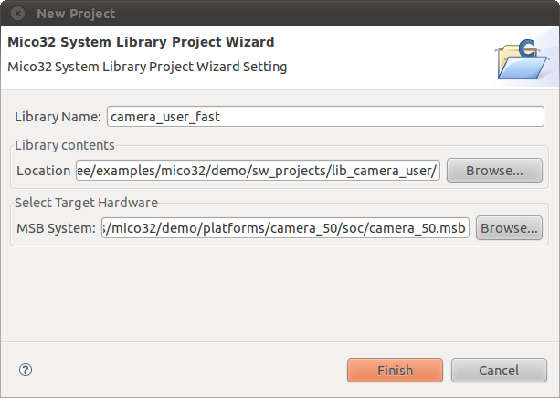

# File:Mico32 library project settings.png

[Download original file](../assets/uploads/Mico32_library_project_settings--213f9c20b7.png)

Original upload: **Ryosab81**, 2011-02-15T16:53:55Z; 47,921 bytes; `image/png`.

Upload comment: This screenshot shows how to properly edit the mico32 library project settings

This screenshot shows how to properly edit the mico32 library project settings

---

## Archive provenance

- [Original page](http://erika.tuxfamily.org/wiki/index.php?title=File%3AMico32_library_project_settings.png) · [Archived source revision 2633](http://erika.tuxfamily.org/wiki/index.php?oldid=2633)
- Last source edit: 2011-02-15T16:53:55Z. Source retrieved on 2026-11-06; Markdown conversion completed on 2026-11-07.
- Original contributors recorded in exported history: Ryosab81.
- [Original MediaWiki source](../source/wikitext/1789.mediawiki) · [Original editing history](../source/history/batch-041.xml)
- [Attribution and licensing notice](../NOTICE.md). Original file-specific notices, where present, remain applicable.
