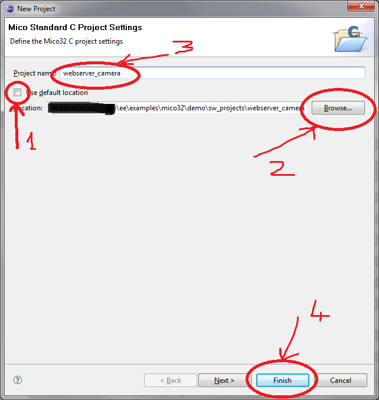

# File:Mico32 standardmakec wizard.png

[Download original file](../assets/uploads/Mico32_standardmakec_wizard--5754739928.png)

Original upload: **Eguidieri**, 2011-10-07T11:38:25Z; 51,338 bytes; `image/png`.

---

## Archive provenance

- [Original page](http://erika.tuxfamily.org/wiki/index.php?title=File%3AMico32_standardmakec_wizard.png) · [Archived source revision 3721](http://erika.tuxfamily.org/wiki/index.php?oldid=3721)
- Last source edit: 2011-10-07T11:38:25Z. Source retrieved on 2026-11-06; Markdown conversion completed on 2026-11-07.
- Original contributors recorded in exported history: Eguidieri.
- [Original MediaWiki source](../source/wikitext/2119.mediawiki) · [Original editing history](../source/history/batch-041.xml)
- [Attribution and licensing notice](../NOTICE.md). Original file-specific notices, where present, remain applicable.
