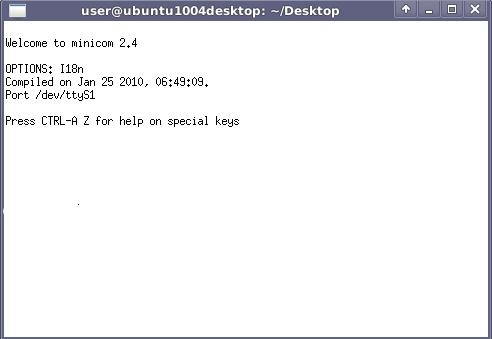

# File:Minicom.png

[Download original file](../assets/uploads/Minicom--c8533ac4ae.png)

Original upload: **Salva**, 2012-01-19T16:18:56Z; 8,872 bytes; `image/png`.

---

## Archive provenance

- [Original page](http://erika.tuxfamily.org/wiki/index.php?title=File%3AMinicom.png) · [Archived source revision 4357](http://erika.tuxfamily.org/wiki/index.php?oldid=4357)
- Last source edit: 2012-01-19T16:18:56Z. Source retrieved on 2026-11-06; Markdown conversion completed on 2026-11-07.
- Original contributors recorded in exported history: Salva.
- [Original MediaWiki source](../source/wikitext/2233.mediawiki) · [Original editing history](../source/history/batch-041.xml)
- [Attribution and licensing notice](../NOTICE.md). Original file-specific notices, where present, remain applicable.
