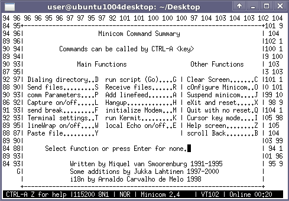

# File:Minicom capture on off.png

[Download original file](../assets/uploads/Minicom_capture_on_off--15b284dccc.png)

Original upload: **Salva**, 2012-01-20T10:49:09Z; 16,929 bytes; `image/png`.

---

## Archive provenance

- [Original page](http://erika.tuxfamily.org/wiki/index.php?title=File%3AMinicom_capture_on_off.png) · [Archived source revision 4372](http://erika.tuxfamily.org/wiki/index.php?oldid=4372)
- Last source edit: 2012-01-20T10:49:09Z. Source retrieved on 2026-11-06; Markdown conversion completed on 2026-11-07.
- Original contributors recorded in exported history: Salva.
- [Original MediaWiki source](../source/wikitext/2238.mediawiki) · [Original editing history](../source/history/batch-041.xml)
- [Attribution and licensing notice](../NOTICE.md). Original file-specific notices, where present, remain applicable.
