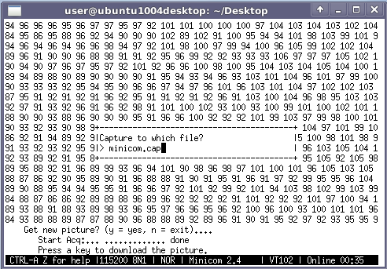

# File:Minicom capture which file.png

[Download original file](../assets/uploads/Minicom_capture_which_file--618e4499b0.png)

Original upload: **Salva**, 2012-01-20T10:55:14Z; 17,497 bytes; `image/png`.

---

## Archive provenance

- [Original page](http://erika.tuxfamily.org/wiki/index.php?title=File%3AMinicom_capture_which_file.png) · [Archived source revision 4374](http://erika.tuxfamily.org/wiki/index.php?oldid=4374)
- Last source edit: 2012-01-20T10:55:14Z. Source retrieved on 2026-11-06; Markdown conversion completed on 2026-11-07.
- Original contributors recorded in exported history: Salva.
- [Original MediaWiki source](../source/wikitext/2239.mediawiki) · [Original editing history](../source/history/batch-041.xml)
- [Attribution and licensing notice](../NOTICE.md). Original file-specific notices, where present, remain applicable.
