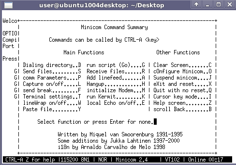

# File:Minicom configure.png

[Download original file](../assets/uploads/Minicom_configure--023d4f3109.png)

Original upload: **Salva**, 2012-01-19T16:40:53Z; 14,953 bytes; `image/png`.

---

## Archive provenance

- [Original page](http://erika.tuxfamily.org/wiki/index.php?title=File%3AMinicom_configure.png) · [Archived source revision 4360](http://erika.tuxfamily.org/wiki/index.php?oldid=4360)
- Last source edit: 2012-01-19T16:40:53Z. Source retrieved on 2026-11-06; Markdown conversion completed on 2026-11-07.
- Original contributors recorded in exported history: Salva.
- [Original MediaWiki source](../source/wikitext/2234.mediawiki) · [Original editing history](../source/history/batch-041.xml)
- [Attribution and licensing notice](../NOTICE.md). Original file-specific notices, where present, remain applicable.
