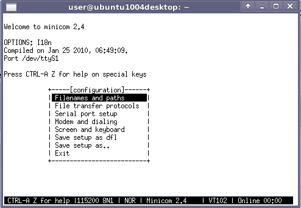

# File:Minicom o options.png

[Download original file](../assets/uploads/Minicom_o_options--890892e8eb.png)

Original upload: **Salva**, 2012-01-20T08:27:04Z; 12,815 bytes; `image/png`.

---

## Archive provenance

- [Original page](http://erika.tuxfamily.org/wiki/index.php?title=File%3AMinicom_o_options.png) · [Archived source revision 4363](http://erika.tuxfamily.org/wiki/index.php?oldid=4363)
- Last source edit: 2012-01-20T08:27:05Z. Source retrieved on 2026-11-06; Markdown conversion completed on 2026-11-07.
- Original contributors recorded in exported history: Salva.
- [Original MediaWiki source](../source/wikitext/2235.mediawiki) · [Original editing history](../source/history/batch-042.xml)
- [Attribution and licensing notice](../NOTICE.md). Original file-specific notices, where present, remain applicable.
