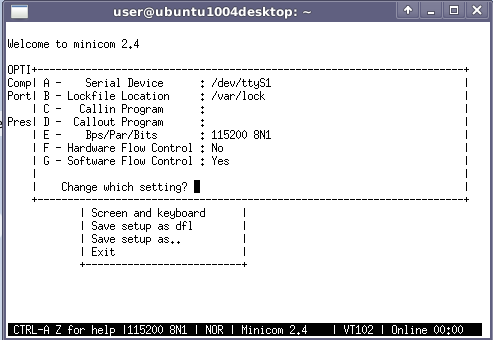

# File:Minicom serial port setup.png

[Download original file](../assets/uploads/Minicom_serial_port_setup--21b57cbd4d.png)

Original upload: **Salva**, 2012-01-20T08:36:21Z; 11,703 bytes; `image/png`.

---

## Archive provenance

- [Original page](http://erika.tuxfamily.org/wiki/index.php?title=File%3AMinicom_serial_port_setup.png) · [Archived source revision 4366](http://erika.tuxfamily.org/wiki/index.php?oldid=4366)
- Last source edit: 2012-01-20T08:36:21Z. Source retrieved on 2026-11-06; Markdown conversion completed on 2026-11-07.
- Original contributors recorded in exported history: Salva.
- [Original MediaWiki source](../source/wikitext/2236.mediawiki) · [Original editing history](../source/history/batch-042.xml)
- [Attribution and licensing notice](../NOTICE.md). Original file-specific notices, where present, remain applicable.
