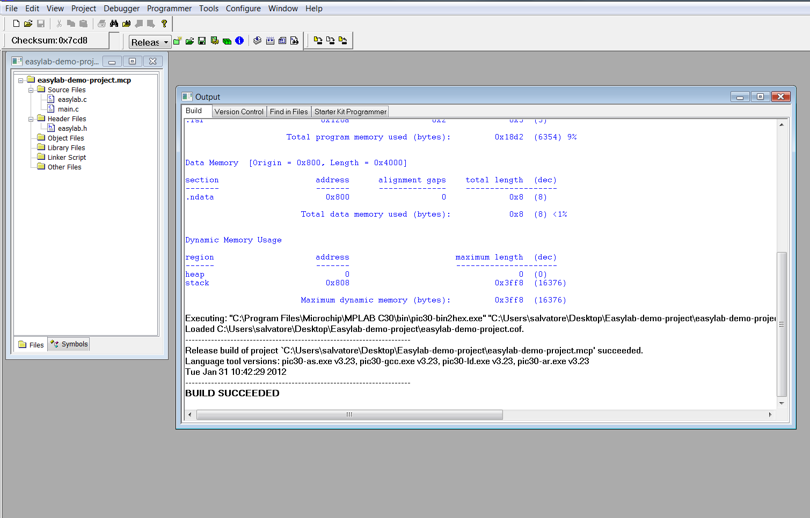

# File:Mplab easylab build.png

[Download original file](../assets/uploads/Mplab_easylab_build--24f2b5cbb0.png)

Original upload: **Salva**, 2012-01-31T09:53:32Z; 47,798 bytes; `image/png`.

---

## Archive provenance

- [Original page](http://erika.tuxfamily.org/wiki/index.php?title=File%3AMplab_easylab_build.png) · [Archived source revision 4531](http://erika.tuxfamily.org/wiki/index.php?oldid=4531)
- Last source edit: 2012-01-31T09:53:33Z. Source retrieved on 2026-11-06; Markdown conversion completed on 2026-11-07.
- Original contributors recorded in exported history: Salva.
- [Original MediaWiki source](../source/wikitext/2266.mediawiki) · [Original editing history](../source/history/batch-042.xml)
- [Attribution and licensing notice](../NOTICE.md). Original file-specific notices, where present, remain applicable.
