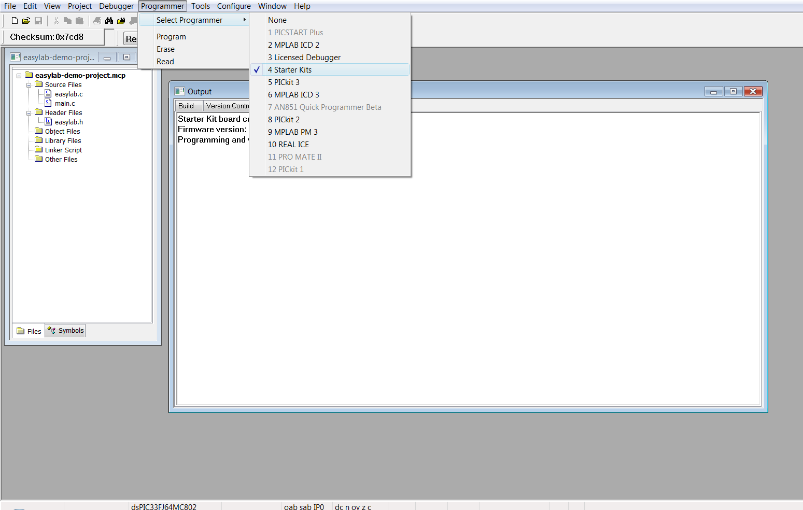

# File:Mplab start kit.png

[Download original file](../assets/uploads/Mplab_start_kit--fd63ee1a89.png)

Original upload: **Salva**, 2012-01-31T09:59:18Z; 50,408 bytes; `image/png`.

---

## Archive provenance

- [Original page](http://erika.tuxfamily.org/wiki/index.php?title=File%3AMplab_start_kit.png) · [Archived source revision 4533](http://erika.tuxfamily.org/wiki/index.php?oldid=4533)
- Last source edit: 2012-01-31T09:59:19Z. Source retrieved on 2026-11-06; Markdown conversion completed on 2026-11-07.
- Original contributors recorded in exported history: Salva.
- [Original MediaWiki source](../source/wikitext/2267.mediawiki) · [Original editing history](../source/history/batch-042.xml)
- [Attribution and licensing notice](../NOTICE.md). Original file-specific notices, where present, remain applicable.
