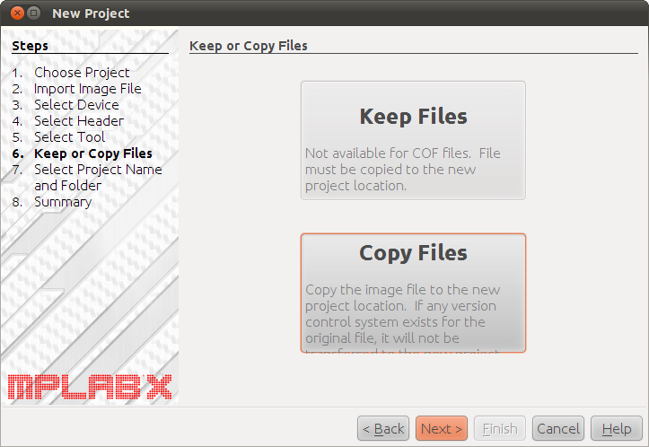

# File:Mplabx.beta4-newproject.06.png

[Download original file](../assets/uploads/Mplabx.beta4-newproject.06--9c18852e15.png)

Original upload: **Rischiav**, 2011-02-03T09:51:35Z; 111,800 bytes; `image/png`.

Upload comment: Mplabx.beta4: how to use a copy of the loadable image file.

Mplabx.beta4: how to use a copy of the loadable image file.

---

## Archive provenance

- [Original page](http://erika.tuxfamily.org/wiki/index.php?title=File%3AMplabx.beta4-newproject.06.png) · [Archived source revision 2291](http://erika.tuxfamily.org/wiki/index.php?oldid=2291)
- Last source edit: 2011-02-03T09:51:35Z. Source retrieved on 2026-11-06; Markdown conversion completed on 2026-11-07.
- Original contributors recorded in exported history: Rischiav.
- [Original MediaWiki source](../source/wikitext/1748.mediawiki) · [Original editing history](../source/history/batch-042.xml)
- [Attribution and licensing notice](../NOTICE.md). Original file-specific notices, where present, remain applicable.
