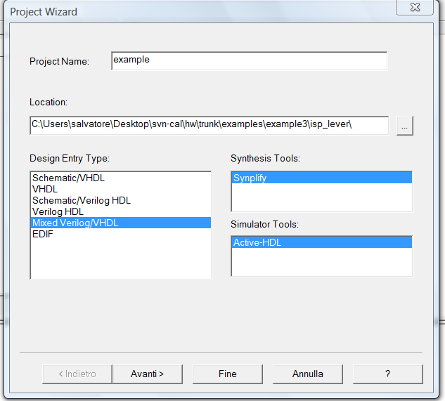

# File:Name project.png

[Download original file](../assets/uploads/Name_project--dbc4a7aa21.png)

Original upload: **Salva**, 2011-02-15T14:36:16Z; 27,763 bytes; `image/png`.

Upload comment: Add name project

Add name project

---

## Archive provenance

- [Original page](http://erika.tuxfamily.org/wiki/index.php?title=File%3AName_project.png) · [Archived source revision 2601](http://erika.tuxfamily.org/wiki/index.php?oldid=2601)
- Last source edit: 2011-02-15T14:36:16Z. Source retrieved on 2026-11-06; Markdown conversion completed on 2026-11-07.
- Original contributors recorded in exported history: Salva.
- [Original MediaWiki source](../source/wikitext/1780.mediawiki) · [Original editing history](../source/history/batch-043.xml)
- [Attribution and licensing notice](../NOTICE.md). Original file-specific notices, where present, remain applicable.
