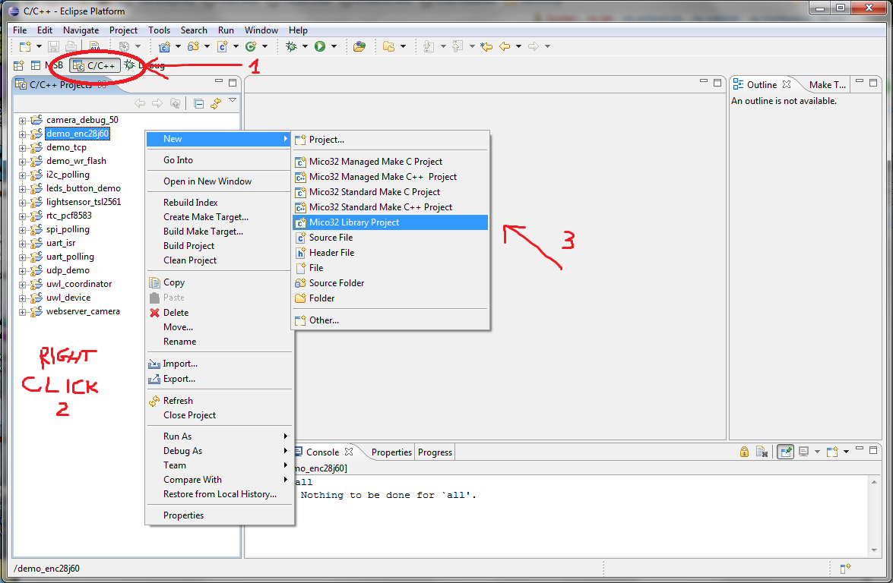

# File:New mico32 library C-C++.png

[Download original file](../assets/uploads/New_mico32_library_C-C--3d87cb4ec5.png)

Original upload: **Eguidieri**, 2011-10-07T09:52:22Z; 140,280 bytes; `image/png`.

---

## Archive provenance

- [Original page](http://erika.tuxfamily.org/wiki/index.php?title=File%3ANew_mico32_library_C-C%2B%2B.png) · [Archived source revision 3707](http://erika.tuxfamily.org/wiki/index.php?oldid=3707)
- Last source edit: 2011-10-07T09:52:22Z. Source retrieved on 2026-11-06; Markdown conversion completed on 2026-11-07.
- Original contributors recorded in exported history: Eguidieri.
- [Original MediaWiki source](../source/wikitext/2115.mediawiki) · [Original editing history](../source/history/batch-044.xml)
- [Attribution and licensing notice](../NOTICE.md). Original file-specific notices, where present, remain applicable.
