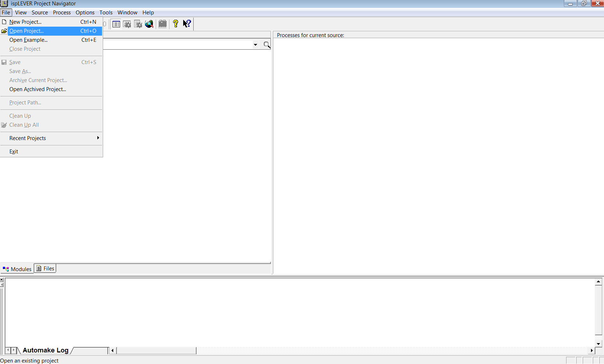

# File:Open project from ispLever ide.png

[Download original file](../assets/uploads/Open_project_from_ispLever_ide--82dafd4647.png)

Original upload: **Salva**, 2011-10-04T10:16:02Z; 38,681 bytes; `image/png`.

---

## Archive provenance

- [Original page](http://erika.tuxfamily.org/wiki/index.php?title=File%3AOpen_project_from_ispLever_ide.png) · [Archived source revision 3607](http://erika.tuxfamily.org/wiki/index.php?oldid=3607)
- Last source edit: 2011-10-04T10:16:02Z. Source retrieved on 2026-11-06; Markdown conversion completed on 2026-11-07.
- Original contributors recorded in exported history: Salva.
- [Original MediaWiki source](../source/wikitext/2106.mediawiki) · [Original editing history](../source/history/batch-044.xml)
- [Attribution and licensing notice](../NOTICE.md). Original file-specific notices, where present, remain applicable.
