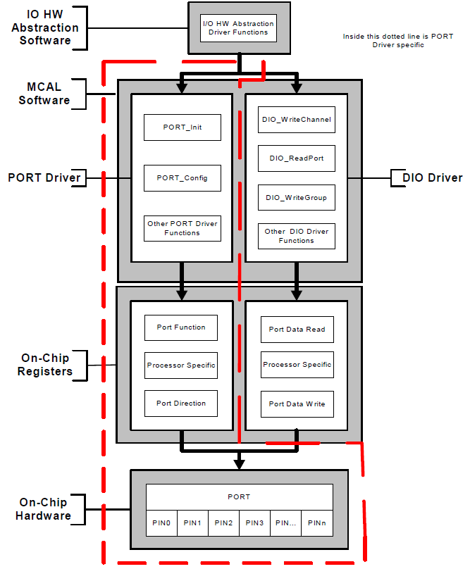

# File:PORT-DIO.png

[Download original file](../assets/uploads/PORT-DIO--50a05ce6db.png)

Original upload: **Giuseppe Serano**, 2013-07-16T15:52:12Z; 41,607 bytes; `image/png`.

Upload comment: PORT DIO

PORT DIO

---

## Archive provenance

- [Original page](http://erika.tuxfamily.org/wiki/index.php?title=File%3APORT-DIO.png) · [Archived source revision 5209](http://erika.tuxfamily.org/wiki/index.php?oldid=5209)
- Last source edit: 2013-07-16T15:52:13Z. Source retrieved on 2026-11-06; Markdown conversion completed on 2026-11-07.
- Original contributors recorded in exported history: Giuseppe Serano.
- [Original MediaWiki source](../source/wikitext/2381.mediawiki) · [Original editing history](../source/history/batch-044.xml)
- [Attribution and licensing notice](../NOTICE.md). Original file-specific notices, where present, remain applicable.
