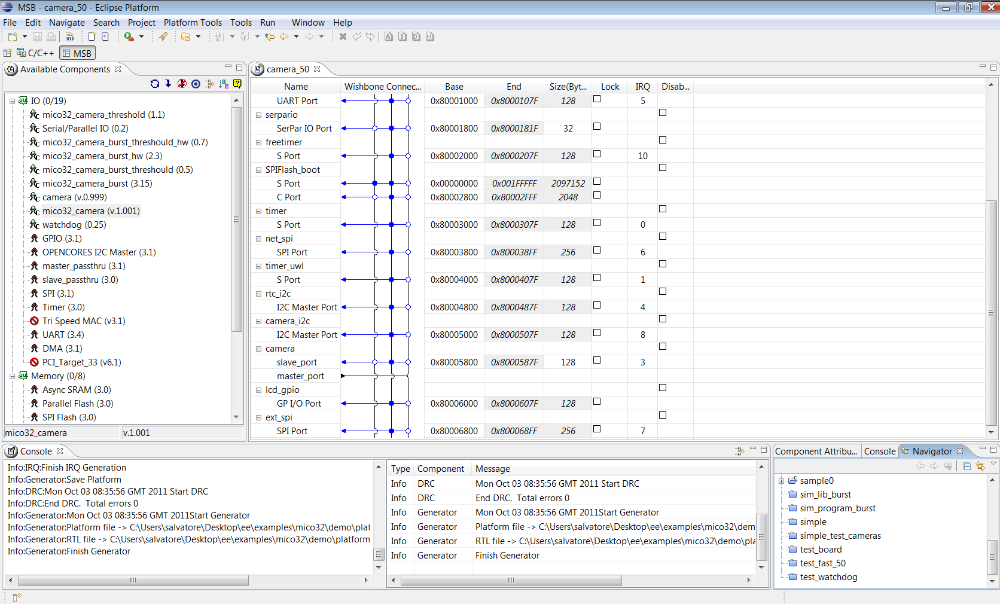

# File:Platform architecture from msb ide.png

[Download original file](../assets/uploads/Platform_architecture_from_msb_ide--86a7a85980.png)

Original upload: **Salva**, 2011-10-04T09:36:21Z; 144,761 bytes; `image/png`.

---

## Archive provenance

- [Original page](http://erika.tuxfamily.org/wiki/index.php?title=File%3APlatform_architecture_from_msb_ide.png) · [Archived source revision 3599](http://erika.tuxfamily.org/wiki/index.php?oldid=3599)
- Last source edit: 2011-10-04T09:36:21Z. Source retrieved on 2026-11-06; Markdown conversion completed on 2026-11-07.
- Original contributors recorded in exported history: Salva.
- [Original MediaWiki source](../source/wikitext/2104.mediawiki) · [Original editing history](../source/history/batch-045.xml)
- [Attribution and licensing notice](../NOTICE.md). Original file-specific notices, where present, remain applicable.
