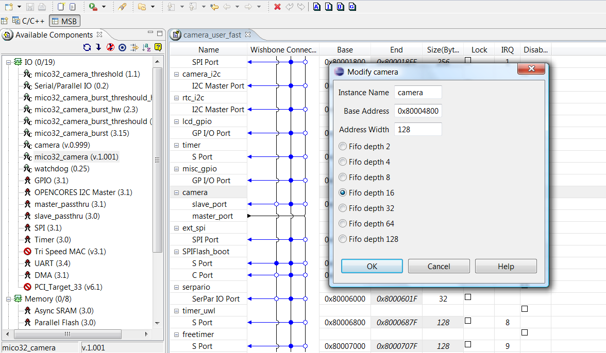

# File:Platform with camera.png

[Download original file](../assets/uploads/Platform_with_camera--4022272adc.png)

Original upload: **Salva**, 2011-09-26T10:40:11Z; 184,654 bytes; `image/png`.

Upload comment: mico32_camera values in the platform.

mico32\_camera values in the platform.

---

## Archive provenance

- [Original page](http://erika.tuxfamily.org/wiki/index.php?title=File%3APlatform_with_camera.png) · [Archived source revision 3282](http://erika.tuxfamily.org/wiki/index.php?oldid=3282)
- Last source edit: 2011-09-26T10:40:11Z. Source retrieved on 2026-11-06; Markdown conversion completed on 2026-11-07.
- Original contributors recorded in exported history: Salva.
- [Original MediaWiki source](../source/wikitext/2070.mediawiki) · [Original editing history](../source/history/batch-045.xml)
- [Attribution and licensing notice](../NOTICE.md). Original file-specific notices, where present, remain applicable.
