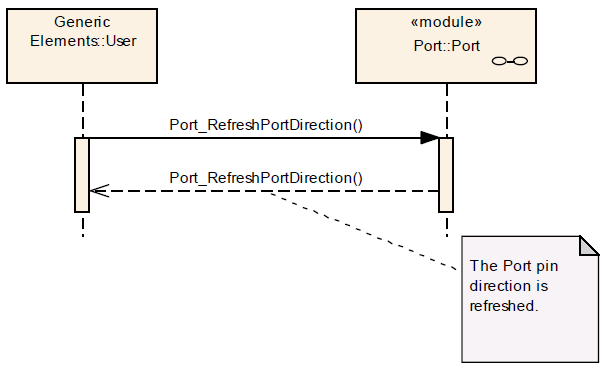

# File:Port RefreshPortDirection Seq Dia.png

[Download original file](../assets/uploads/Port_RefreshPortDirection_Seq_Dia--b3c8cc6e58.png)

Original upload: **Giuseppe Serano**, 2013-07-16T16:37:25Z; 17,009 bytes; `image/png`.

Upload comment: Port_RefreshPortDirection() Sequence Diagram.

Port\_RefreshPortDirection() Sequence Diagram.

---

## Archive provenance

- [Original page](http://erika.tuxfamily.org/wiki/index.php?title=File%3APort_RefreshPortDirection_Seq_Dia.png) · [Archived source revision 5217](http://erika.tuxfamily.org/wiki/index.php?oldid=5217)
- Last source edit: 2013-07-16T16:37:25Z. Source retrieved on 2026-11-06; Markdown conversion completed on 2026-11-07.
- Original contributors recorded in exported history: Giuseppe Serano.
- [Original MediaWiki source](../source/wikitext/2387.mediawiki) · [Original editing history](../source/history/batch-045.xml)
- [Attribution and licensing notice](../NOTICE.md). Original file-specific notices, where present, remain applicable.
