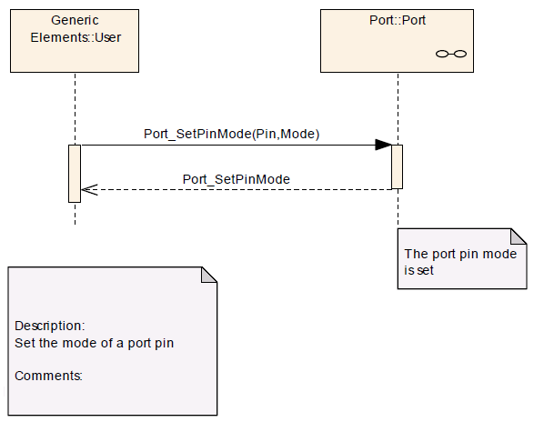

# File:Port SetPinMode Seq Dia.png

[Download original file](../assets/uploads/Port_SetPinMode_Seq_Dia--d7c77dcdc7.png)

Original upload: **Giuseppe Serano**, 2013-07-16T16:38:01Z; 18,244 bytes; `image/png`.

Upload comment: Port_SetPinMode() Sequence Diagram.

Port\_SetPinMode() Sequence Diagram.

---

## Archive provenance

- [Original page](http://erika.tuxfamily.org/wiki/index.php?title=File%3APort_SetPinMode_Seq_Dia.png) · [Archived source revision 5218](http://erika.tuxfamily.org/wiki/index.php?oldid=5218)
- Last source edit: 2013-07-16T16:38:01Z. Source retrieved on 2026-11-06; Markdown conversion completed on 2026-11-07.
- Original contributors recorded in exported history: Giuseppe Serano.
- [Original MediaWiki source](../source/wikitext/2388.mediawiki) · [Original editing history](../source/history/batch-045.xml)
- [Attribution and licensing notice](../NOTICE.md). Original file-specific notices, where present, remain applicable.
