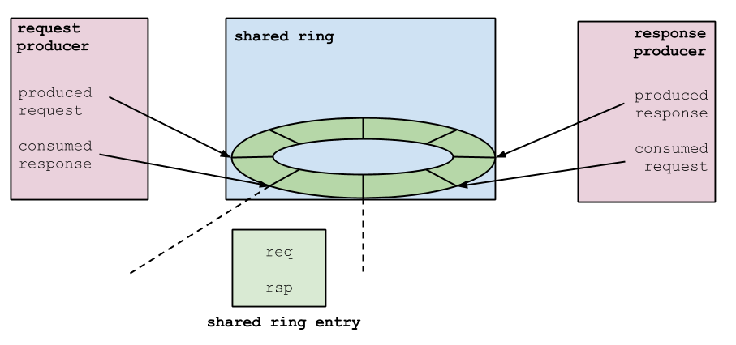

# File:Prod-cons-ringbuffer.png

[Download original file](../assets/uploads/Prod-cons-ringbuffer--3e64471518.png)

Original upload: **Arianna Avanzini**, 2015-02-02T17:00:00Z; 31,010 bytes; `image/png`.

Upload comment: Schematic representation of a Xen ringbuffer as used to implement a producer-consumer interaction between XenBus clients.

Schematic representation of a Xen ringbuffer as used to implement a producer-consumer interaction between XenBus clients.

---

## Archive provenance

- [Original page](http://erika.tuxfamily.org/wiki/index.php?title=File%3AProd-cons-ringbuffer.png) · [Archived source revision 5976](http://erika.tuxfamily.org/wiki/index.php?oldid=5976)
- Last source edit: 2015-02-02T17:00:00Z. Source retrieved on 2026-11-06; Markdown conversion completed on 2026-11-07.
- Original contributors recorded in exported history: Arianna Avanzini.
- [Original MediaWiki source](../source/wikitext/2508.mediawiki) · [Original editing history](../source/history/batch-046.xml)
- [Attribution and licensing notice](../NOTICE.md). Original file-specific notices, where present, remain applicable.
