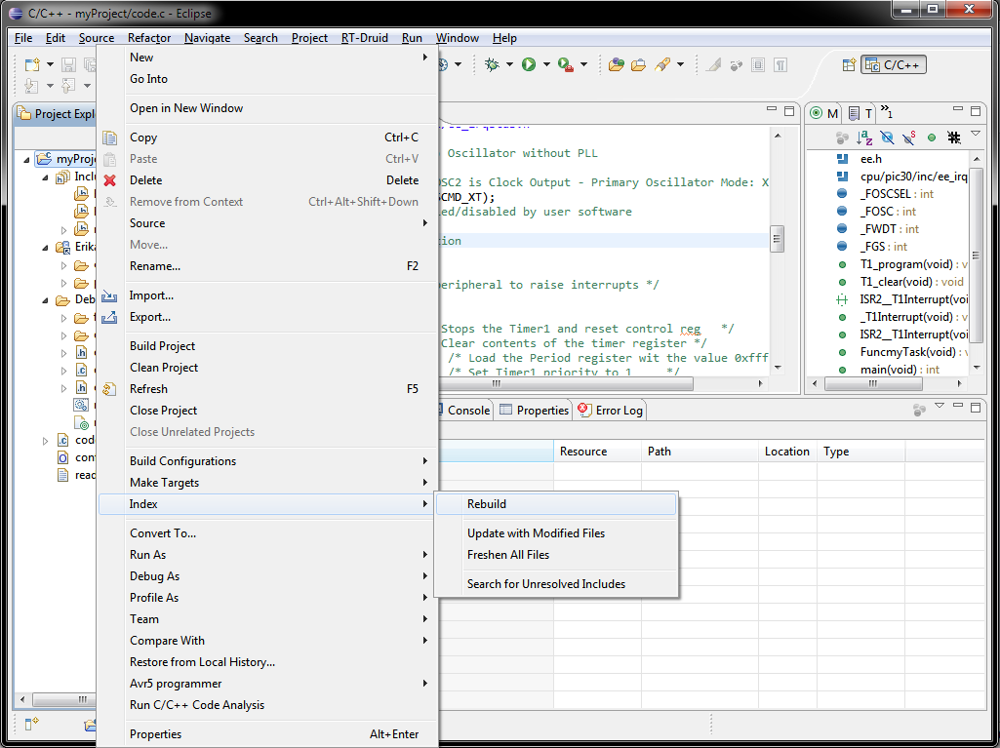

# File:Project rebuild index.png

[Download original file](../assets/uploads/Project_rebuild_index--9a30d4d42b.png)

Original upload: **Nicola**, 2011-10-18T14:50:52Z; 98,228 bytes; `image/png`.

---

## Archive provenance

- [Original page](http://erika.tuxfamily.org/wiki/index.php?title=File%3AProject_rebuild_index.png) · [Archived source revision 3921](http://erika.tuxfamily.org/wiki/index.php?oldid=3921)
- Last source edit: 2011-10-18T14:50:52Z. Source retrieved on 2026-11-06; Markdown conversion completed on 2026-11-07.
- Original contributors recorded in exported history: Nicola.
- [Original MediaWiki source](../source/wikitext/2146.mediawiki) · [Original editing history](../source/history/batch-046.xml)
- [Attribution and licensing notice](../NOTICE.md). Original file-specific notices, where present, remain applicable.
