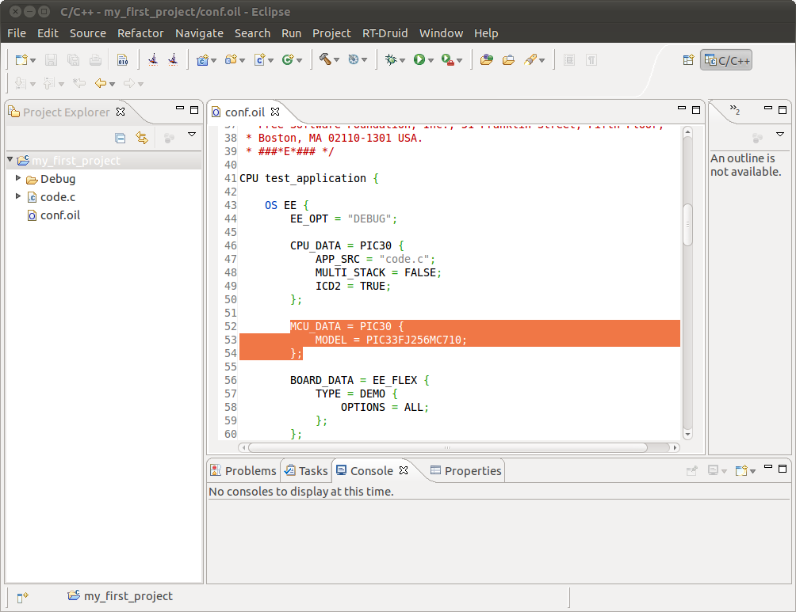

# File:RT-Druid.1.6.0-PICModel.01.png

[Download original file](../assets/uploads/RT-Druid.1.6.0-PICModel.01--24a7499fe5.png)

Original upload: **Rischiav**, 2011-02-03T09:16:15Z; 93,995 bytes; `image/png`.

Upload comment: RT-Druid 1.6.0: PIC model

RT-Druid 1.6.0: PIC model

---

## Archive provenance

- [Original page](http://erika.tuxfamily.org/wiki/index.php?title=File%3ART-Druid.1.6.0-PICModel.01.png) · [Archived source revision 2286](http://erika.tuxfamily.org/wiki/index.php?oldid=2286)
- Last source edit: 2011-02-03T09:16:15Z. Source retrieved on 2026-11-06; Markdown conversion completed on 2026-11-07.
- Original contributors recorded in exported history: Rischiav.
- [Original MediaWiki source](../source/wikitext/1744.mediawiki) · [Original editing history](../source/history/batch-046.xml)
- [Attribution and licensing notice](../NOTICE.md). Original file-specific notices, where present, remain applicable.
