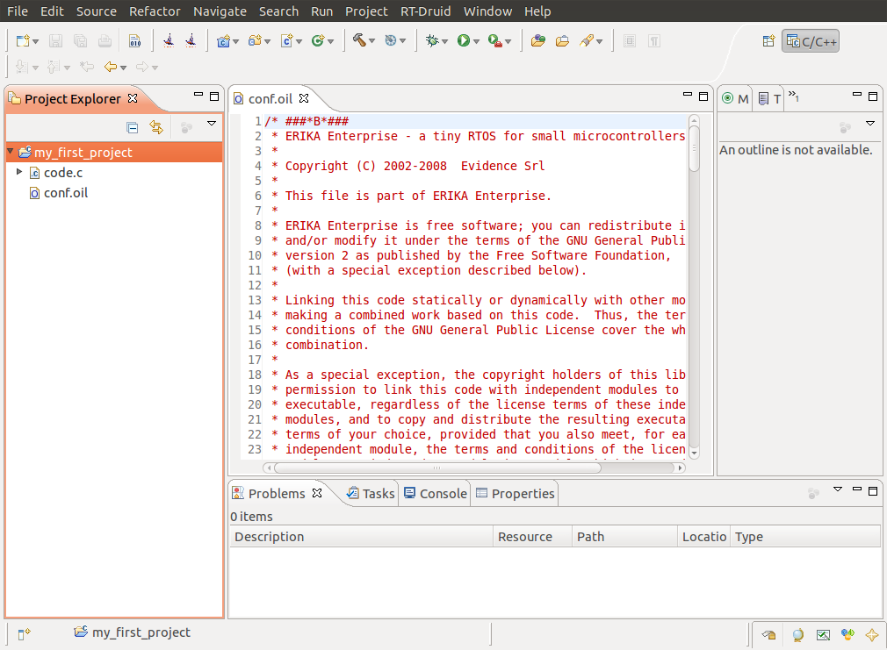

# File:RT-druid.1.6.0-newproject.04.png

[Download original file](../assets/uploads/RT-druid.1.6.0-newproject.04--610e2bf3a5.png)

Original upload: **Rischiav**, 2011-02-02T13:53:16Z; 116,972 bytes; `image/png`.

Upload comment: RT-Druid 1.6.0 beta new template based project.

RT-Druid 1.6.0 beta new template based project.

---

## Archive provenance

- [Original page](http://erika.tuxfamily.org/wiki/index.php?title=File%3ART-druid.1.6.0-newproject.04.png) · [Archived source revision 2266](http://erika.tuxfamily.org/wiki/index.php?oldid=2266)
- Last source edit: 2011-02-02T13:53:17Z. Source retrieved on 2026-11-06; Markdown conversion completed on 2026-11-07.
- Original contributors recorded in exported history: Rischiav.
- [Original MediaWiki source](../source/wikitext/1736.mediawiki) · [Original editing history](../source/history/batch-047.xml)
- [Attribution and licensing notice](../NOTICE.md). Original file-specific notices, where present, remain applicable.
