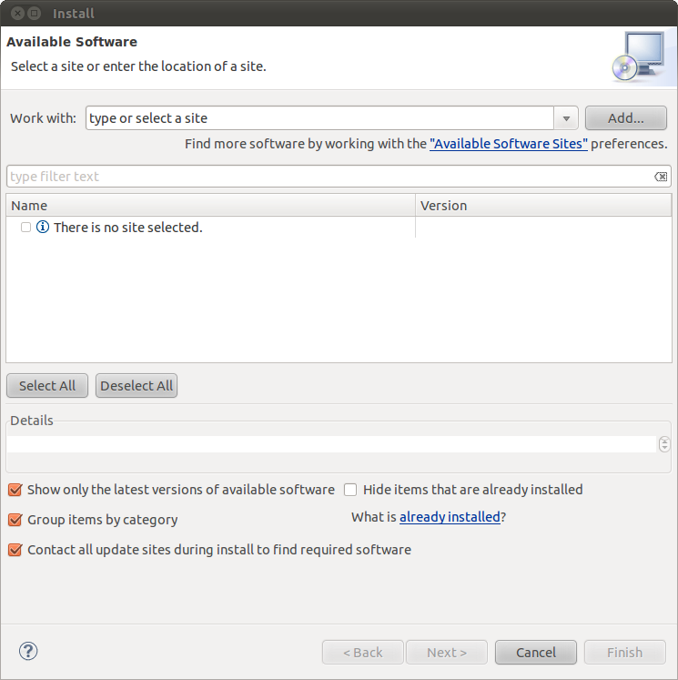

# File:RT-druid.1.6.0-update.02.png

[Download original file](../assets/uploads/RT-druid.1.6.0-update.02--77ca629ca4.png)

Original upload: **Rischiav**, 2011-02-02T11:42:56Z; 60,405 bytes; `image/png`.

Upload comment: RT-Druid 1.6.0 beta enabling updates install window

RT-Druid 1.6.0 beta enabling updates install window

---

## Archive provenance

- [Original page](http://erika.tuxfamily.org/wiki/index.php?title=File%3ART-druid.1.6.0-update.02.png) · [Archived source revision 2244](http://erika.tuxfamily.org/wiki/index.php?oldid=2244)
- Last source edit: 2011-02-02T11:42:57Z. Source retrieved on 2026-11-06; Markdown conversion completed on 2026-11-07.
- Original contributors recorded in exported history: Rischiav.
- [Original MediaWiki source](../source/wikitext/1724.mediawiki) · [Original editing history](../source/history/batch-047.xml)
- [Attribution and licensing notice](../NOTICE.md). Original file-specific notices, where present, remain applicable.
