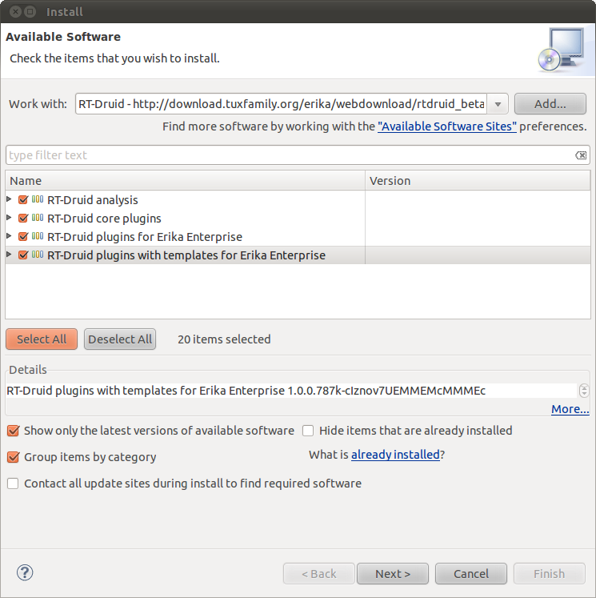

# File:RT-druid.1.6.0-update.04.png

[Download original file](../assets/uploads/RT-druid.1.6.0-update.04--fe51723b24.png)

Original upload: **Rischiav**, 2011-02-02T11:47:39Z; 85,802 bytes; `image/png`.

Upload comment: RT-Druid 1.6.0 beta enabling updates repos

RT-Druid 1.6.0 beta enabling updates repos

---

## Archive provenance

- [Original page](http://erika.tuxfamily.org/wiki/index.php?title=File%3ART-druid.1.6.0-update.04.png) · [Archived source revision 2246](http://erika.tuxfamily.org/wiki/index.php?oldid=2246)
- Last source edit: 2011-02-02T11:47:39Z. Source retrieved on 2026-11-06; Markdown conversion completed on 2026-11-07.
- Original contributors recorded in exported history: Rischiav.
- [Original MediaWiki source](../source/wikitext/1726.mediawiki) · [Original editing history](../source/history/batch-047.xml)
- [Attribution and licensing notice](../NOTICE.md). Original file-specific notices, where present, remain applicable.
