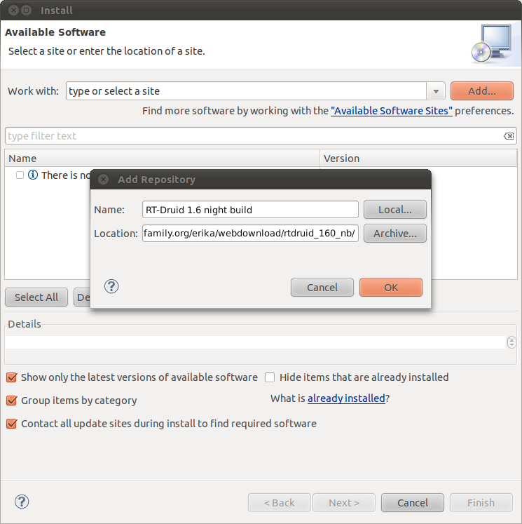

# File:RT-druid.1.6.0-update nb.03.png

[Download original file](../assets/uploads/RT-druid.1.6.0-update_nb.03--6ffd228c7a.png)

Original upload: **Nicola**, 2011-05-02T11:41:42Z; 89,619 bytes; `image/png`.

---

## Archive provenance

- [Original page](http://erika.tuxfamily.org/wiki/index.php?title=File%3ART-druid.1.6.0-update_nb.03.png) · [Archived source revision 3090](http://erika.tuxfamily.org/wiki/index.php?oldid=3090)
- Last source edit: 2011-05-02T11:41:42Z. Source retrieved on 2026-11-06; Markdown conversion completed on 2026-11-07.
- Original contributors recorded in exported history: Nicola.
- [Original MediaWiki source](../source/wikitext/2050.mediawiki) · [Original editing history](../source/history/batch-047.xml)
- [Attribution and licensing notice](../NOTICE.md). Original file-specific notices, where present, remain applicable.
