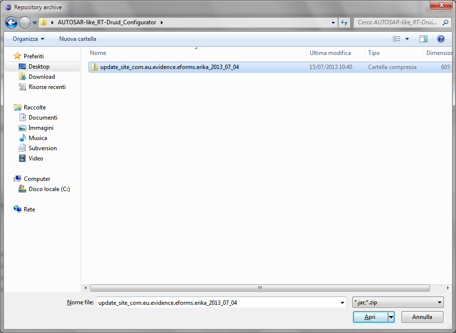

# File:Repository Archive.png

[Download original file](../assets/uploads/Repository_Archive--782bb24d58.png)

Original upload: **Eguidieri**, 2013-07-16T09:33:48Z; 68,995 bytes; `image/png`.

Upload comment: Repository Archive

Repository Archive

---

## Archive provenance

- [Original page](http://erika.tuxfamily.org/wiki/index.php?title=File%3ARepository_Archive.png) · [Archived source revision 5158](http://erika.tuxfamily.org/wiki/index.php?oldid=5158)
- Last source edit: 2013-07-16T09:33:48Z. Source retrieved on 2026-11-06; Markdown conversion completed on 2026-11-07.
- Original contributors recorded in exported history: Eguidieri.
- [Original MediaWiki source](../source/wikitext/2358.mediawiki) · [Original editing history](../source/history/batch-048.xml)
- [Attribution and licensing notice](../NOTICE.md). Original file-specific notices, where present, remain applicable.
