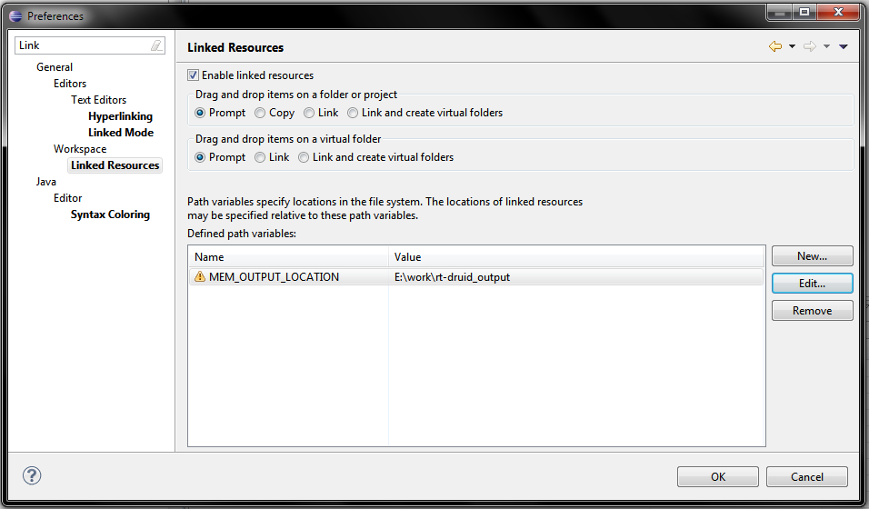

# File:Rtd mem output.png

[Download original file](../assets/uploads/Rtd_mem_output--7583315c2d.png)

Original upload: **WikiSysop**, 2011-07-19T23:57:12Z; 47,863 bytes; `image/png`.

---

## Archive provenance

- [Original page](http://erika.tuxfamily.org/wiki/index.php?title=File%3ARtd_mem_output.png) · [Archived source revision 3162](http://erika.tuxfamily.org/wiki/index.php?oldid=3162)
- Last source edit: 2011-07-19T23:57:12Z. Source retrieved on 2026-11-06; Markdown conversion completed on 2026-11-07.
- Original contributors recorded in exported history: WikiSysop.
- [Original MediaWiki source](../source/wikitext/2061.mediawiki) · [Original editing history](../source/history/batch-048.xml)
- [Attribution and licensing notice](../NOTICE.md). Original file-specific notices, where present, remain applicable.
