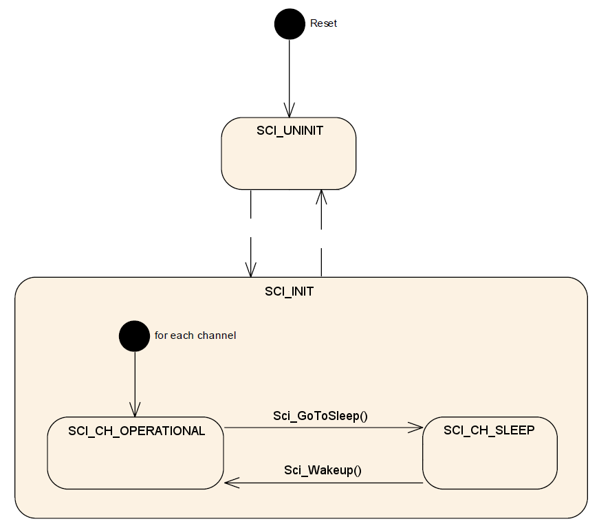

# File:SCI STATE.png

[Download original file](../assets/uploads/SCI_STATE--7c82b9e766.png)

Original upload: **Giuseppe Serano**, 2013-07-16T20:50:32Z; 30,012 bytes; `image/png`.

Upload comment: SCI State Machine.

SCI State Machine.

---

## Archive provenance

- [Original page](http://erika.tuxfamily.org/wiki/index.php?title=File%3ASCI_STATE.png) · [Archived source revision 5252](http://erika.tuxfamily.org/wiki/index.php?oldid=5252)
- Last source edit: 2013-07-16T20:50:32Z. Source retrieved on 2026-11-06; Markdown conversion completed on 2026-11-07.
- Original contributors recorded in exported history: Giuseppe Serano.
- [Original MediaWiki source](../source/wikitext/2408.mediawiki) · [Original editing history](../source/history/batch-049.xml)
- [Attribution and licensing notice](../NOTICE.md). Original file-specific notices, where present, remain applicable.
