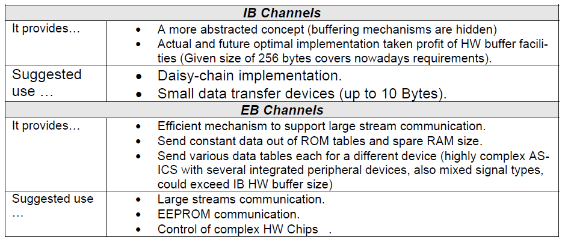

# File:SPI Buffering Channel Usage Table.png

[Download original file](../assets/uploads/SPI_Buffering_Channel_Usage_Table--1ae665a0e5.png)

Original upload: **Giuseppe Serano**, 2013-07-18T09:23:19Z; 73,964 bytes; `image/png`.

---

## Archive provenance

- [Original page](http://erika.tuxfamily.org/wiki/index.php?title=File%3ASPI_Buffering_Channel_Usage_Table.png) · [Archived source revision 5317](http://erika.tuxfamily.org/wiki/index.php?oldid=5317)
- Last source edit: 2013-07-18T09:23:20Z. Source retrieved on 2026-11-06; Markdown conversion completed on 2026-11-07.
- Original contributors recorded in exported history: Giuseppe Serano.
- [Original MediaWiki source](../source/wikitext/2439.mediawiki) · [Original editing history](../source/history/batch-049.xml)
- [Attribution and licensing notice](../NOTICE.md). Original file-specific notices, where present, remain applicable.
