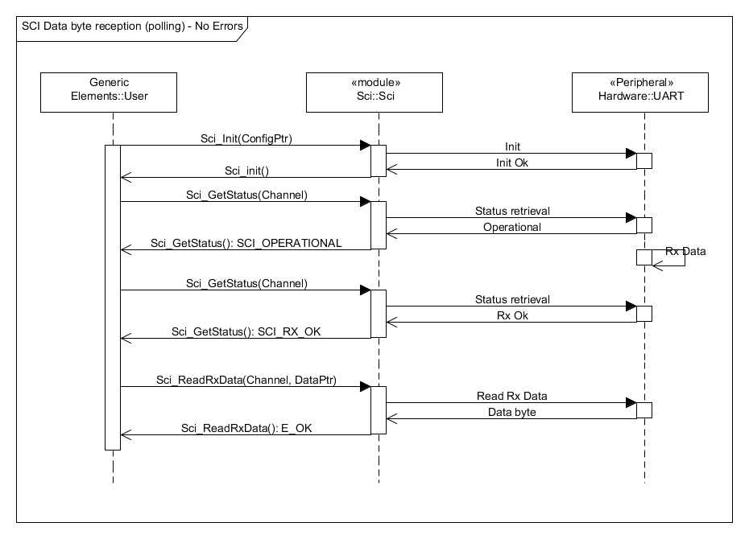

# File:Sci ReadRxData Seq Dia.png

[Download original file](../assets/uploads/Sci_ReadRxData_Seq_Dia--1474fc8ca0.png)

Original upload: **Giuseppe Serano**, 2013-07-16T20:58:06Z; 33,552 bytes; `image/png`.

Upload comment: Sci_ReadRxData() Sequence Diagram (polling).

Sci\_ReadRxData() Sequence Diagram (polling).

---

## Archive provenance

- [Original page](http://erika.tuxfamily.org/wiki/index.php?title=File%3ASci_ReadRxData_Seq_Dia.png) · [Archived source revision 5259](http://erika.tuxfamily.org/wiki/index.php?oldid=5259)
- Last source edit: 2013-07-16T20:58:06Z. Source retrieved on 2026-11-06; Markdown conversion completed on 2026-11-07.
- Original contributors recorded in exported history: Giuseppe Serano.
- [Original MediaWiki source](../source/wikitext/2411.mediawiki) · [Original editing history](../source/history/batch-049.xml)
- [Attribution and licensing notice](../NOTICE.md). Original file-specific notices, where present, remain applicable.
