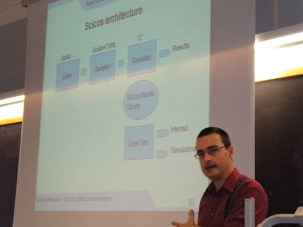

# File:Scicoslab2010 02 simone.jpg

[Download original file](../assets/uploads/Scicoslab2010_02_simone--e6e2e8a306.jpg)

Original upload: **Paolo.gai**, 2010-10-21T14:39:42Z; 53,566 bytes; `image/jpeg`.

Upload comment: Simone explaining the ScicosLab code generation process...

Simone explaining the ScicosLab code generation process...

---

## Archive provenance

- [Original page](http://erika.tuxfamily.org/wiki/index.php?title=File%3AScicoslab2010_02_simone.jpg) · [Archived source revision 2074](http://erika.tuxfamily.org/wiki/index.php?oldid=2074)
- Last source edit: 2010-10-21T14:39:42Z. Source retrieved on 2026-11-06; Markdown conversion completed on 2026-11-07.
- Original contributors recorded in exported history: Paolo.gai.
- [Original MediaWiki source](../source/wikitext/1671.mediawiki) · [Original editing history](../source/history/batch-050.xml)
- [Attribution and licensing notice](../NOTICE.md). Original file-specific notices, where present, remain applicable.
