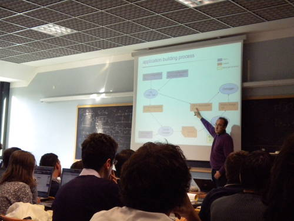

# File:Scicoslab2010 03 pj.jpg

[Download original file](../assets/uploads/Scicoslab2010_03_pj--32dbaf45cd.jpg)

Original upload: **Paolo.gai**, 2010-10-21T14:41:46Z; 65,549 bytes; `image/jpeg`.

Upload comment: PJ explaining the ERIKA Enterprise workflow.

PJ explaining the ERIKA Enterprise workflow.

---

## Archive provenance

- [Original page](http://erika.tuxfamily.org/wiki/index.php?title=File%3AScicoslab2010_03_pj.jpg) · [Archived source revision 2076](http://erika.tuxfamily.org/wiki/index.php?oldid=2076)
- Last source edit: 2010-10-21T14:41:46Z. Source retrieved on 2026-11-06; Markdown conversion completed on 2026-11-07.
- Original contributors recorded in exported history: Paolo.gai.
- [Original MediaWiki source](../source/wikitext/1672.mediawiki) · [Original editing history](../source/history/batch-050.xml)
- [Attribution and licensing notice](../NOTICE.md). Original file-specific notices, where present, remain applicable.
