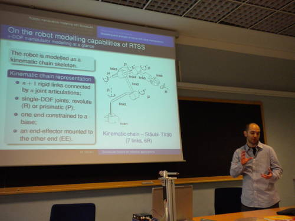

# File:Scicoslab2010 09 matteo.jpg

[Download original file](../assets/uploads/Scicoslab2010_09_matteo--420fbadef6.jpg)

Original upload: **Paolo.gai**, 2010-10-21T15:00:41Z; 62,394 bytes; `image/jpeg`.

Upload comment: Matteo making a mimic of a robot...

Matteo making a mimic of a robot...

---

## Archive provenance

- [Original page](http://erika.tuxfamily.org/wiki/index.php?title=File%3AScicoslab2010_09_matteo.jpg) · [Archived source revision 2084](http://erika.tuxfamily.org/wiki/index.php?oldid=2084)
- Last source edit: 2010-10-21T15:00:41Z. Source retrieved on 2026-11-06; Markdown conversion completed on 2026-11-07.
- Original contributors recorded in exported history: Paolo.gai.
- [Original MediaWiki source](../source/wikitext/1678.mediawiki) · [Original editing history](../source/history/batch-051.xml)
- [Attribution and licensing notice](../NOTICE.md). Original file-specific notices, where present, remain applicable.
