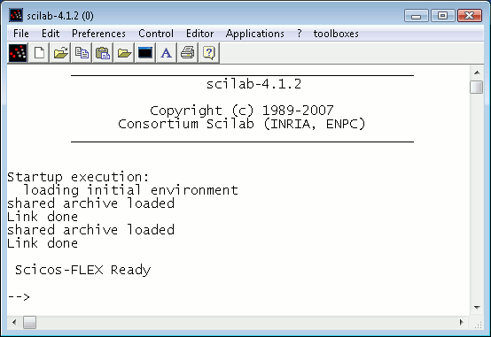

# File:Scilab splash.png

[Download original file](../assets/uploads/Scilab_splash--f6045b6410.png)

Original upload: **Paolo.gai**, 2011-02-24T11:20:57Z; 6,862 bytes; `image/png`.

---

## Archive provenance

- [Original page](http://erika.tuxfamily.org/wiki/index.php?title=File%3AScilab_splash.png) · [Archived source revision 2731](http://erika.tuxfamily.org/wiki/index.php?oldid=2731)
- Last source edit: 2011-02-24T11:20:58Z. Source retrieved on 2026-11-06; Markdown conversion completed on 2026-11-07.
- Original contributors recorded in exported history: Paolo.gai.
- [Original MediaWiki source](../source/wikitext/1802.mediawiki) · [Original editing history](../source/history/batch-051.xml)
- [Attribution and licensing notice](../NOTICE.md). Original file-specific notices, where present, remain applicable.
