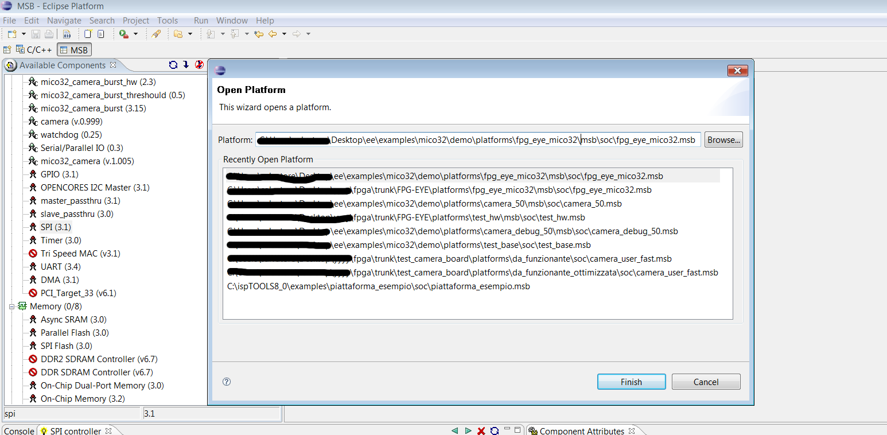

# File:Select fpg eye mico32 msb from msb ide.png

[Download original file](../assets/uploads/Select_fpg_eye_mico32_msb_from_msb_ide--cb3dc9f0d9.png)

Original upload: **Salva**, 2011-11-07T11:21:22Z; 103,860 bytes; `image/png`.

---

## Archive provenance

- [Original page](http://erika.tuxfamily.org/wiki/index.php?title=File%3ASelect_fpg_eye_mico32_msb_from_msb_ide.png) · [Archived source revision 4036](http://erika.tuxfamily.org/wiki/index.php?oldid=4036)
- Last source edit: 2011-11-07T11:21:23Z. Source retrieved on 2026-11-06; Markdown conversion completed on 2026-11-07.
- Original contributors recorded in exported history: Salva.
- [Original MediaWiki source](../source/wikitext/2162.mediawiki) · [Original editing history](../source/history/batch-052.xml)
- [Attribution and licensing notice](../NOTICE.md). Original file-specific notices, where present, remain applicable.
