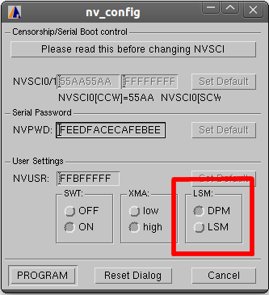

# File:Set lock step.png

[Download original file](../assets/uploads/Set_lock_step--4b0e4d5f33.png)

Original upload: **Francesco**, 2014-11-10T13:42:14Z; 10,304 bytes; `image/png`.

---

## Archive provenance

- [Original page](http://erika.tuxfamily.org/wiki/index.php?title=File%3ASet_lock_step.png) · [Archived source revision 5897](http://erika.tuxfamily.org/wiki/index.php?oldid=5897)
- Last source edit: 2014-11-10T13:42:14Z. Source retrieved on 2026-11-06; Markdown conversion completed on 2026-11-07.
- Original contributors recorded in exported history: Francesco.
- [Original MediaWiki source](../source/wikitext/2494.mediawiki) · [Original editing history](../source/history/batch-052.xml)
- [Attribution and licensing notice](../NOTICE.md). Original file-specific notices, where present, remain applicable.
