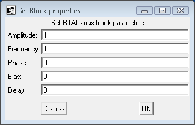

# File:Sineproperties.png

[Download original file](../assets/uploads/Sineproperties--1a83cc3283.png)

Original upload: **Paolo.gai**, 2011-02-24T11:23:11Z; 2,730 bytes; `image/png`.

---

## Archive provenance

- [Original page](http://erika.tuxfamily.org/wiki/index.php?title=File%3ASineproperties.png) · [Archived source revision 2742](http://erika.tuxfamily.org/wiki/index.php?oldid=2742)
- Last source edit: 2011-02-24T11:23:11Z. Source retrieved on 2026-11-06; Markdown conversion completed on 2026-11-07.
- Original contributors recorded in exported history: Paolo.gai.
- [Original MediaWiki source](../source/wikitext/1813.mediawiki) · [Original editing history](../source/history/batch-052.xml)
- [Attribution and licensing notice](../NOTICE.md). Original file-specific notices, where present, remain applicable.
