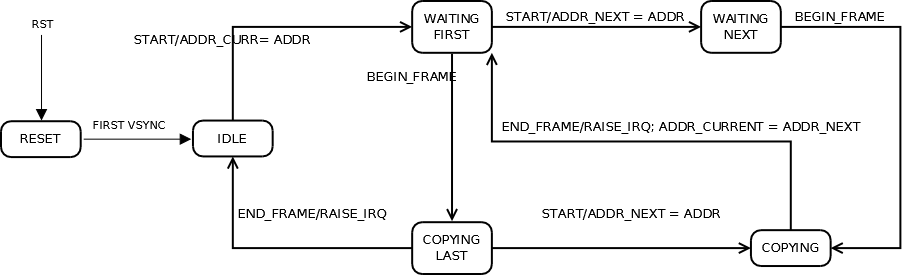

# File:State mico32 camera.png

[Download original file](../assets/uploads/State_mico32_camera--dcbc709287.png)

Original upload: **Salva**, 2011-09-27T10:03:05Z; 18,366 bytes; `image/png`.

---

## Archive provenance

- [Original page](http://erika.tuxfamily.org/wiki/index.php?title=File%3AState_mico32_camera.png) · [Archived source revision 3371](http://erika.tuxfamily.org/wiki/index.php?oldid=3371)
- Last source edit: 2011-09-27T10:03:05Z. Source retrieved on 2026-11-06; Markdown conversion completed on 2026-11-07.
- Original contributors recorded in exported history: Salva.
- [Original MediaWiki source](../source/wikitext/2071.mediawiki) · [Original editing history](../source/history/batch-054.xml)
- [Attribution and licensing notice](../NOTICE.md). Original file-specific notices, where present, remain applicable.
