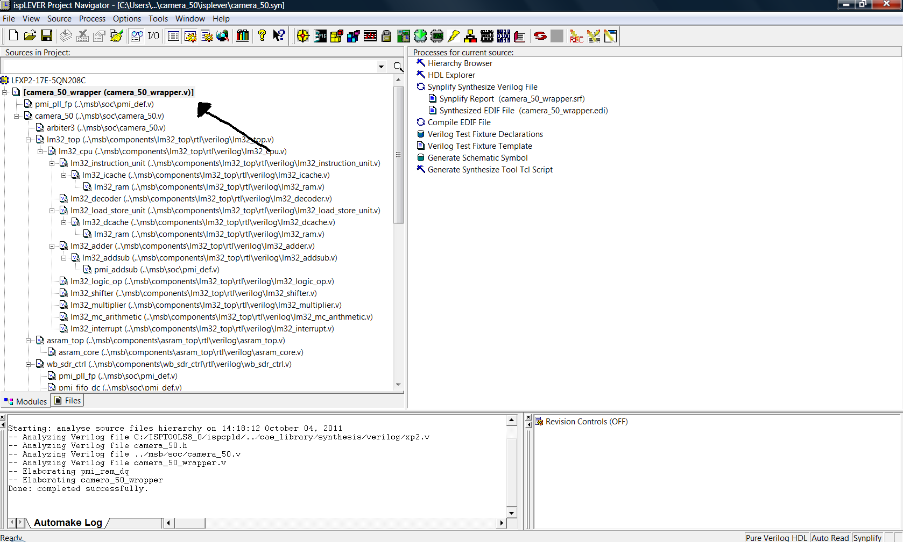

# File:Struct camera 50 from ispLever ide.png

[Download original file](../assets/uploads/Struct_camera_50_from_ispLever_ide--b2b14e24bc.png)

Original upload: **Salva**, 2011-10-04T12:25:23Z; 120,020 bytes; `image/png`.

---

## Archive provenance

- [Original page](http://erika.tuxfamily.org/wiki/index.php?title=File%3AStruct_camera_50_from_ispLever_ide.png) · [Archived source revision 3613](http://erika.tuxfamily.org/wiki/index.php?oldid=3613)
- Last source edit: 2011-10-04T12:25:23Z. Source retrieved on 2026-11-06; Markdown conversion completed on 2026-11-07.
- Original contributors recorded in exported history: Salva.
- [Original MediaWiki source](../source/wikitext/2108.mediawiki) · [Original editing history](../source/history/batch-054.xml)
- [Attribution and licensing notice](../NOTICE.md). Original file-specific notices, where present, remain applicable.
