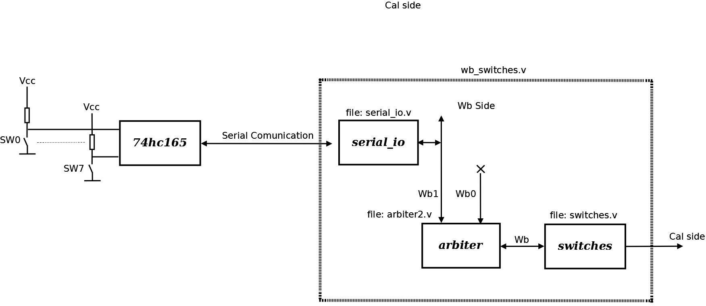

# File:Switches.png

[Download original file](../assets/uploads/Switches--1df5f2a3c1.png)

Original upload: **Salva**, 2011-02-21T14:43:40Z; 55,390 bytes; `image/png`.

System Actors Switches structure

---

## Archive provenance

- [Original page](http://erika.tuxfamily.org/wiki/index.php?title=File%3ASwitches.png) · [Archived source revision 2708](http://erika.tuxfamily.org/wiki/index.php?oldid=2708)
- Last source edit: 2011-02-21T14:43:40Z. Source retrieved on 2026-11-06; Markdown conversion completed on 2026-11-07.
- Original contributors recorded in exported history: Salva.
- [Original MediaWiki source](../source/wikitext/1775.mediawiki) · [Original editing history](../source/history/batch-054.xml)
- [Attribution and licensing notice](../NOTICE.md). Original file-specific notices, where present, remain applicable.
