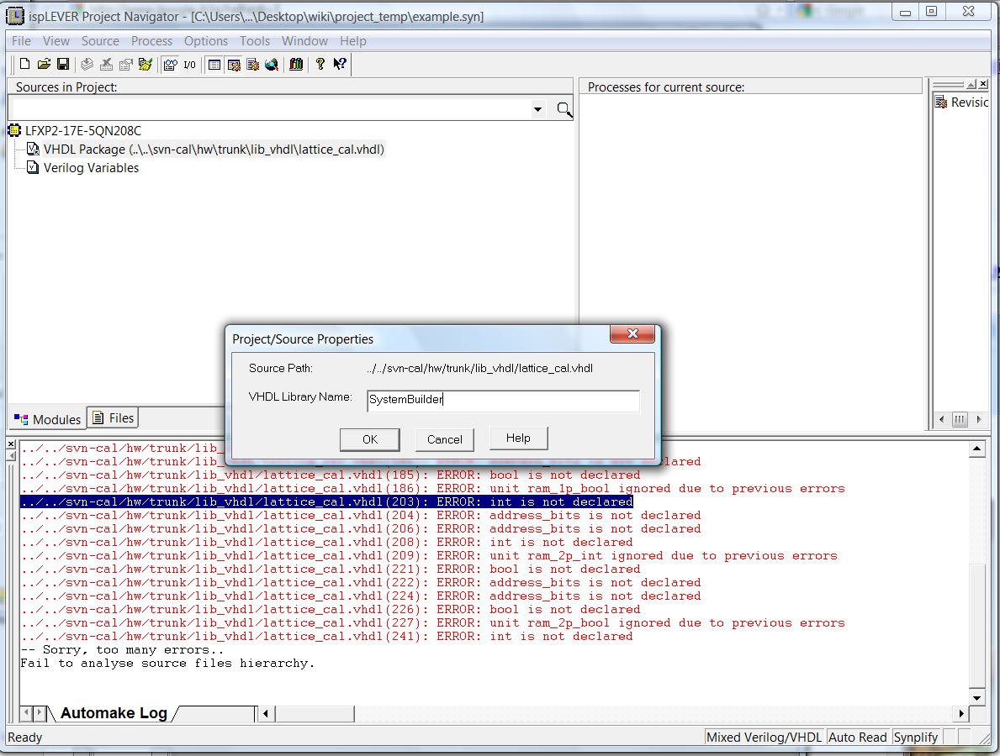

# File:System builder.png

[Download original file](../assets/uploads/System_builder--20b0ffeb39.png)

Original upload: **Salva**, 2011-02-15T15:59:30Z; 111,800 bytes; `image/png`.

Upload comment: Nomespace

Nomespace

---

## Archive provenance

- [Original page](http://erika.tuxfamily.org/wiki/index.php?title=File%3ASystem_builder.png) · [Archived source revision 2626](http://erika.tuxfamily.org/wiki/index.php?oldid=2626)
- Last source edit: 2011-02-15T15:59:32Z. Source retrieved on 2026-11-06; Markdown conversion completed on 2026-11-07.
- Original contributors recorded in exported history: Salva.
- [Original MediaWiki source](../source/wikitext/1787.mediawiki) · [Original editing history](../source/history/batch-054.xml)
- [Attribution and licensing notice](../NOTICE.md). Original file-specific notices, where present, remain applicable.
