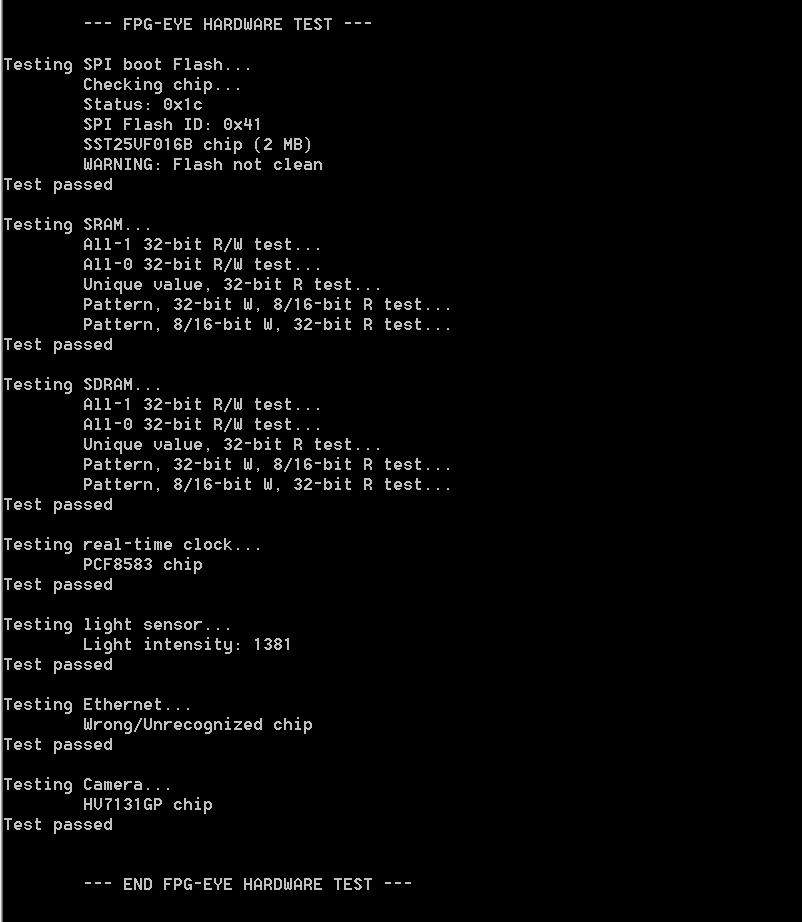

# File:Test no working fpg eye.png

[Download original file](../assets/uploads/Test_no_working_fpg_eye--ec1981282b.png)

Original upload: **Salva**, 2011-10-28T10:07:32Z; 17,369 bytes; `image/png`.

---

## Archive provenance

- [Original page](http://erika.tuxfamily.org/wiki/index.php?title=File%3ATest_no_working_fpg_eye.png) · [Archived source revision 3991](http://erika.tuxfamily.org/wiki/index.php?oldid=3991)
- Last source edit: 2011-10-28T10:07:32Z. Source retrieved on 2026-11-06; Markdown conversion completed on 2026-11-07.
- Original contributors recorded in exported history: Salva.
- [Original MediaWiki source](../source/wikitext/2154.mediawiki) · [Original editing history](../source/history/batch-054.xml)
- [Attribution and licensing notice](../NOTICE.md). Original file-specific notices, where present, remain applicable.
