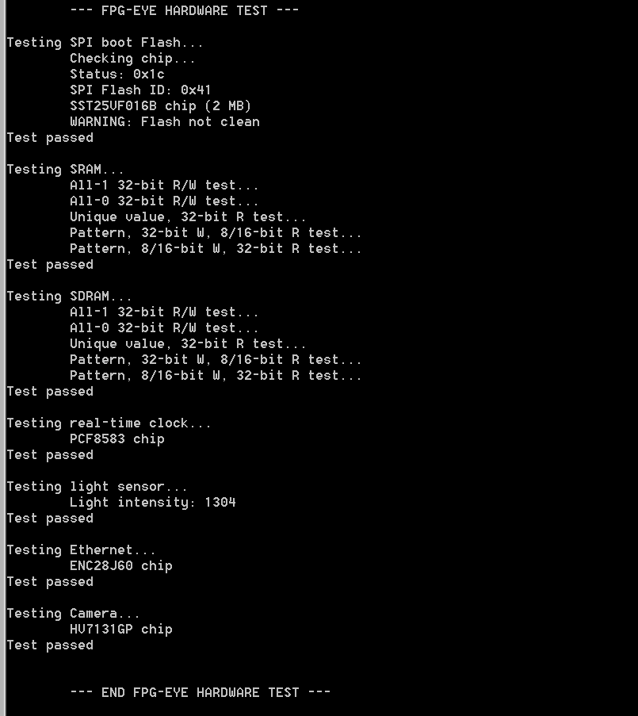

# File:Test working fpg eye.png

[Download original file](../assets/uploads/Test_working_fpg_eye--adeaf53524.png)

Original upload: **Salva**, 2011-10-28T09:32:11Z; 17,412 bytes; `image/png`.

---

## Archive provenance

- [Original page](http://erika.tuxfamily.org/wiki/index.php?title=File%3ATest_working_fpg_eye.png) · [Archived source revision 3988](http://erika.tuxfamily.org/wiki/index.php?oldid=3988)
- Last source edit: 2011-10-28T09:32:11Z. Source retrieved on 2026-11-06; Markdown conversion completed on 2026-11-07.
- Original contributors recorded in exported history: Salva.
- [Original MediaWiki source](../source/wikitext/2153.mediawiki) · [Original editing history](../source/history/batch-054.xml)
- [Attribution and licensing notice](../NOTICE.md). Original file-specific notices, where present, remain applicable.
