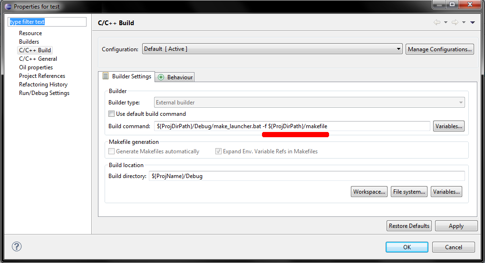

# File:Tutorial proj prop add custom makefile.png

[Download original file](../assets/uploads/Tutorial_proj_prop_add_custom_makefile--bcefc2eb82.png)

Original upload: **Nicola**, 2011-05-03T12:27:02Z; 51,516 bytes; `image/png`.

---

## Archive provenance

- [Original page](http://erika.tuxfamily.org/wiki/index.php?title=File%3ATutorial_proj_prop_add_custom_makefile.png) · [Archived source revision 3104](http://erika.tuxfamily.org/wiki/index.php?oldid=3104)
- Last source edit: 2011-05-03T12:27:02Z. Source retrieved on 2026-11-06; Markdown conversion completed on 2026-11-07.
- Original contributors recorded in exported history: Nicola.
- [Original MediaWiki source](../source/wikitext/2053.mediawiki) · [Original editing history](../source/history/batch-054.xml)
- [Attribution and licensing notice](../NOTICE.md). Original file-specific notices, where present, remain applicable.
