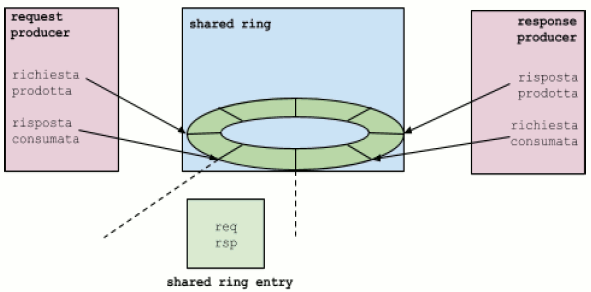

# File:Xen app ring.png

[Download original file](../assets/uploads/Xen_app_ring--4b40b7842d.png)

Original upload: **Pj**, 2015-01-29T14:16:59Z; 16,819 bytes; `image/png`.

Upload comment: Generic scheme of the usage of the ring buffer inside the Xen ARM PV protocol

Generic scheme of the usage of the ring buffer inside the Xen ARM PV protocol

---

## Archive provenance

- [Original page](http://erika.tuxfamily.org/wiki/index.php?title=File%3AXen_app_ring.png) · [Archived source revision 5965](http://erika.tuxfamily.org/wiki/index.php?oldid=5965)
- Last source edit: 2015-01-29T14:16:59Z. Source retrieved on 2026-11-06; Markdown conversion completed on 2026-11-07.
- Original contributors recorded in exported history: Pj.
- [Original MediaWiki source](../source/wikitext/2502.mediawiki) · [Original editing history](../source/history/batch-056.xml)
- [Attribution and licensing notice](../NOTICE.md). Original file-specific notices, where present, remain applicable.
