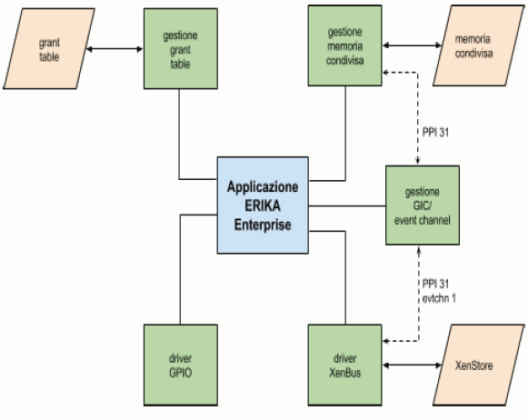

# File:Xen erika app.png

[Download original file](../assets/uploads/Xen_erika_app--250b66f1d6.png)

Original upload: **Pj**, 2015-01-29T13:06:12Z; 16,520 bytes; `image/png`.

Upload comment: Xen components implemented in the example app on ERIKA Enterprise

Xen components implemented in the example app on ERIKA Enterprise

---

## Archive provenance

- [Original page](http://erika.tuxfamily.org/wiki/index.php?title=File%3AXen_erika_app.png) · [Archived source revision 5963](http://erika.tuxfamily.org/wiki/index.php?oldid=5963)
- Last source edit: 2015-01-29T13:06:13Z. Source retrieved on 2026-11-06; Markdown conversion completed on 2026-11-07.
- Original contributors recorded in exported history: Pj.
- [Original MediaWiki source](../source/wikitext/2501.mediawiki) · [Original editing history](../source/history/batch-056.xml)
- [Attribution and licensing notice](../NOTICE.md). Original file-specific notices, where present, remain applicable.
