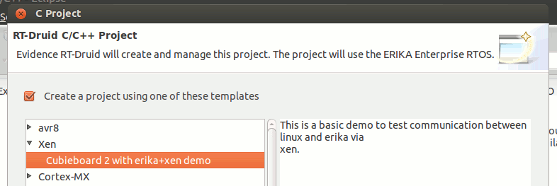

# File:Xen erika example.png

[Download original file](../assets/uploads/Xen_erika_example--5ff6d6043c.png)

Original upload: **Pj**, 2015-01-30T11:53:53Z; 12,500 bytes; `image/png`.

Upload comment: Screenshot of RTDruid on the ERIKA Enterprise VM, highligting the Xen example in the list of templates

Screenshot of RTDruid on the ERIKA Enterprise VM, highligting the Xen example in the list of templates

---

## Archive provenance

- [Original page](http://erika.tuxfamily.org/wiki/index.php?title=File%3AXen_erika_example.png) · [Archived source revision 5971](http://erika.tuxfamily.org/wiki/index.php?oldid=5971)
- Last source edit: 2015-01-30T11:53:54Z. Source retrieved on 2026-11-06; Markdown conversion completed on 2026-11-07.
- Original contributors recorded in exported history: Pj.
- [Original MediaWiki source](../source/wikitext/2505.mediawiki) · [Original editing history](../source/history/batch-056.xml)
- [Attribution and licensing notice](../NOTICE.md). Original file-specific notices, where present, remain applicable.
